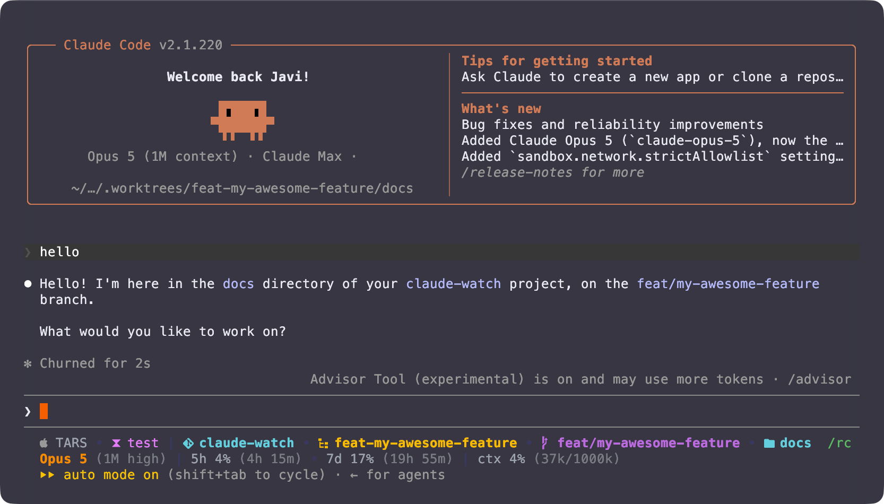
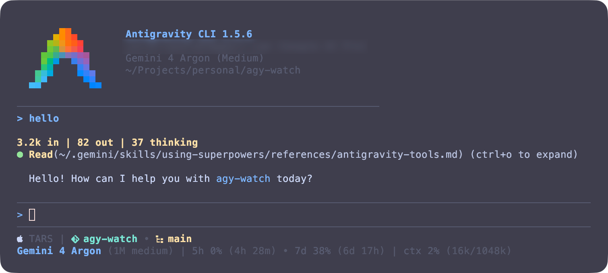

# statusline

A two-line statusline for Claude Code and Antigravity CLI, and the closest
native equivalent for Codex CLI. Formerly three repos: `claude-watch`,
`agy-watch` and `codex-watch`.

Install with `/statusline [claude|agy|codex]`, or by hand:
`scripts/install.sh <harness>` prints the plan and `--yes` applies it.

## claude

[`assets/claude/statusline-command.sh`](assets/claude/statusline-command.sh)
reads the JSON piped by Claude Code and renders two lines.

**Line 1:** platform icon + hostname, the current `zmx` session (only when zmx
is installed and `$ZMX_SESSION` is set), then repo, worktree, branch and
subdirectory, each with its own Nerd Font glyph. Segments run outermost to
innermost, and the optional ones sit at the tail so the leading
`repo • worktree` keeps a stable shape.

- **repo**: the main checkout's name, so it does not change as you move between
  worktrees or into subdirectories. Its glyph follows the SCM: git, subversion,
  or a generic marker for mercurial, jujutsu, fossil and bazaar, which have no
  logo in Nerd Fonts. Outside a repo it falls back to a folder glyph and the
  current directory's name.
- **worktree**: `main` for the main checkout, otherwise the worktree's
  directory name. Git only.
- **branch**: shown only when it differs from the worktree name. Falls back to
  the short commit hash on a detached HEAD. Git only.
- **subdirectory**: the innermost path component below the repo root, omitted
  at the root.

**Line 2:** model and reasoning effort, usage and context window. Every segment
is optional and separators collapse when one is missing.

- **model**: the display name in bold, with a dim suffix for the reasoning
  effort and the 1M-context marker, e.g. `Opus 5 (1M high)`. Tracks mid-session
  `/effort` changes.
- **usage**: the 5-hour and 7-day rate-limit windows with a countdown to each
  reset, straight from Claude Code's JSON: no token, no network call, no cache.
  Absent until the session's first API response, and for accounts without
  subscription rate limits.
- **ctx**: context window percentage and `used/total` tokens.

## agy

[`assets/agy/statusline-command.sh`](assets/agy/statusline-command.sh) has the
same layout, fed by Antigravity's JSON. Line 2 differs in where usage comes
from: the quota buckets under `.quota`, picking `gemini-5h` or `3p-5h` for the
5-hour window and the model's own weekly bucket (`gemini-argon-wtu-weekly`,
`gemini-carbon-wtu-weekly`, `3p-weekly`) for the 7-day one, falling back to
`gemini-weekly`.

## codex

Codex renders its status line from built-in items, so there is no script:
[`assets/codex/config.toml`](assets/codex/config.toml) sets `tui.status_line` to
`hostname`, `project-root`, `git-branch`, `model-with-reasoning`,
`context-used`, `five-hour-limit` and `weekly-limit`. It is a single row, so it
cannot reproduce the two-line layout, the glyphs, the zmx session, the worktree
name or the subdirectory. Items can be reordered with `/statusline` inside
Codex; see the [Codex configuration reference](https://developers.openai.com/codex/config-reference/).

## Dependencies

- `jq`
- `git` (optional, for branch and worktree)
- `zmx` (optional, for the session name)
- A [Nerd Font](https://www.nerdfonts.com/) for the icons

Other SCMs are detected by their marker directory (`.hg`, `.svn`, `.jj`,
`.fslckout`, `.bzr`), so they need not be installed. Works on macOS and Linux.
